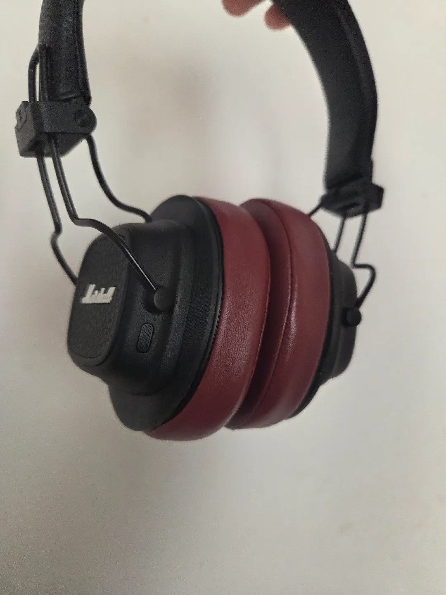
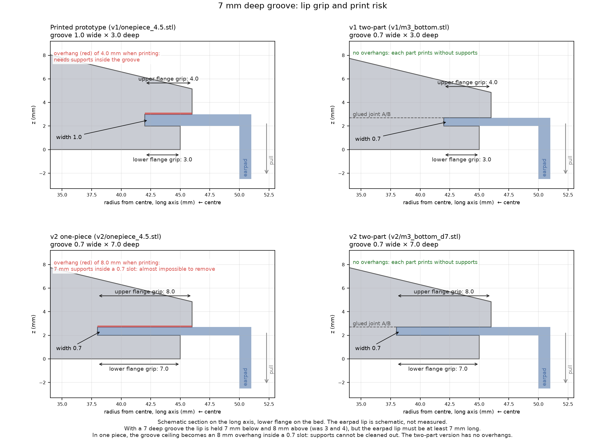
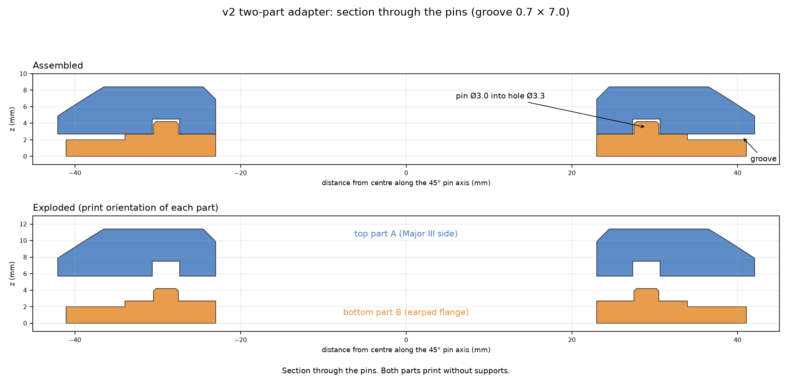
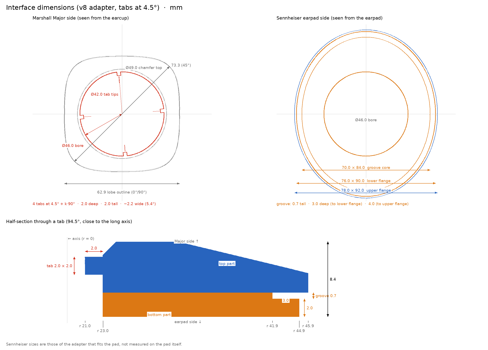
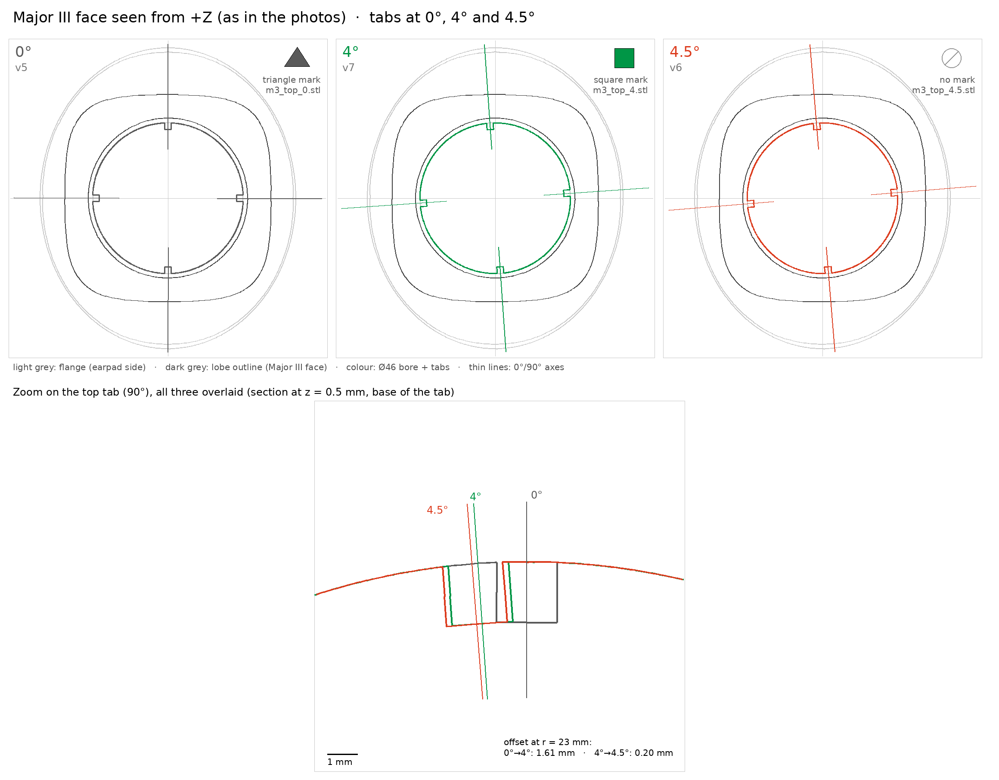

# Marshall Major III earpad adapter

3D-printable adapter that lets you mount aftermarket earpads made for other headphones on Marshall
Major III headphones.

One side clicks into the Major III earcup with 4 tabs. The other side has an oval flange with a
groove that holds the lip of the earpad.

*The printed prototype (`v1/onepiece_4.5.stl`) with aftermarket earpads.*

## Compatible earpads

Earpads with very similar dimensions, so the same adapter fits all of them:

- Sennheiser HD 350BT / HD 450BT
- Skullcandy Crusher
- Sony WH-XB900N

## Layout

| Folder | What it holds |
|---|---|
| `v2/` | current set: groove 0.7 wide × 7.0 deep |
| `v1/` | the printed prototype and the two-part set with a groove 0.7 wide × 3.0 deep |
| `sketches/` | drawings, each in English (`*_en.png`) and Spanish (`*_es.png`) |
| `scripts/` | generators for the bottom part, the one-piece adapter and the sketches |
| `photos/` | the printed prototype mounted on the headphones |
| `original_parts/` | photos of the original Major III earpads and earcup used to shape the adapter and measure the tabs |

## Files to print

The adapter comes in two parts, so neither part needs supports.
Print one top part and one bottom part per ear.

| File (in `v1/` and `v2/`) | Part | Tab angle | ID mark |
|---|---|---|---|
| `m3_top_4.5.stl` | top (Major III side) | 4.5° | none |
| `m3_top_4.stl` | top (Major III side) | 4° | square |
| `m3_top_0.stl` | top (Major III side) | 0° | triangle |
| `m3_bottom.stl` (v1) / `m3_bottom_d7.stl` (v2) | bottom (earpad flange) | — | — |
| `onepiece_4.5.stl` | whole adapter in one piece | 4.5° | — |

- `m3_top_4.5.stl` is the recommended top: the printed prototype (`v1/onepiece_4.5.stl`) has the same
  4.5° tabs and fit the headphones well.
- The top parts are identical in `v1/` and `v2/`; only the bottom part changes the groove depth.
- The ID mark is a shallow shape on the flat underside of the top part. It is hidden once the two
  parts are glued together.
- The bottom part fits every top part. A bottom part with another groove depth can be built with
  `scripts/make_bottom.py` (see [Scripts](#scripts)).
- `v2/onepiece_4.5.stl` has an 8 mm overhang inside a 0.7 mm slot: its supports are almost
  impossible to clean out, so print the two-part version instead.

### Printing

- **Top part:** large flat face on the bed.
- **Bottom part:** flange face on the bed.
- **No supports** for either part.
- **Suggested settings (FDM):** 3 walls, 20–30 % infill, 0.12–0.16 mm layer height (the tabs are
  only 2 mm tall).

### Assembly

1. Fit the earpad lip over the raised core of the bottom part.
2. Put a little glue (CA or epoxy) on top of the core, around the pins. Keep it away from the outer
   edge so it does not run into the groove.
3. Press the top part on. The 4 pins (Ø3.0 mm) go into the 4 holes (Ø3.3 mm).

The joint is permanent.

## Dimensions

All sizes in mm, measured from the v1 two-part adapter (`v1/m3_top_4.5.stl` + `v1/m3_bottom.stl`).

### Marshall Major side (seen from the earcup)

| Feature | Size |
|---|---|
| Bore | Ø46.0 (r 23.0) |
| Tab tips | Ø42.0 (r 21.0) |
| Chamfer top edge | Ø49.0 |
| Tabs | 4 tabs at 4.5° + k·90°; 2.0 deep, 2.0 tall, ~2.2 wide (5.4°) |
| Tab rotation | 4.5° counter-clockwise, seen from the Major side |
| Lobe outline | 62.9 across the axes, 73.3 across the diagonals |

### Earpad side

| Feature | Size |
|---|---|
| Upper flange | 78 × 92 oval (r 45.9 on the long axis) |
| Lower flange | 76 × 90 oval (r 44.9), 2.0 thick |
| Groove core | v1: 70 × 84 oval (r 41.9); v2: 62 × 76 oval (r 37.9) |
| Groove | 0.7 tall; v1: 3.0 deep to the lower flange, 4.0 to the upper; v2: 7.0 and 8.0 |
| Total height (assembled) | 8.4 |

The earpad-side sizes are those of the adapter that fits the pad. They were not measured on the pad
itself.

### Tab rotation

The tab rotation was measured from photos of the original earpads and earcup (folder `original_parts/`).
The measurements ranged from about 3.5° to 5°. That is why there are three top parts with tabs at
0°, 4° and 4.5°.

Between 4° and 4.5° the tab moves only 0.2 mm, which is within normal print tolerance.

## Sketches

| File | What it shows |
|---|---|
| `sketches/dimensions_en.png` | dimensioned drawing of both sides: Major radii and tabs, earpad flange and groove |
| `sketches/tabs_0_4_4.5_en.png` | the 0°, 4° and 4.5° tabs with the ID mark of each top part |
| `sketches/v1_section_en.png` | section of the v1 two-part adapter through the pins, assembled and exploded |
| `sketches/v2_section_en.png` | same section for v2 |
| `sketches/v2_groove_risk_en.png` | groove grip and print overhang of the printed prototype, v1 and v2 |

Every sketch has a Spanish version with the same name ending in `_es.png`.

The one-piece versions in `v1/` and `v2/` need supports inside the groove, which are hard to clean
out. That is why the two-part design exists.

## Scripts

Install the dependencies with `pip install -r requirements.txt`.

| Script | Usage |
|---|---|
| `make_bottom.py` | `make_bottom.py v1/m3_bottom.stl OUT.stl DEPTH`: bottom part with another groove depth |
| `make_onepiece.py` | `make_onepiece.py v1/onepiece_4.5.stl BOTTOM.stl OUT.stl`: one-piece adapter from a bottom part |
| `sketch_section.py` | `sketch_section.py TOP.stl BOTTOM.stl OUT.png {en,es} TITLE`: section through the pins |
| `sketch_groove_risk.py` | `sketch_groove_risk.py OUT.png {en,es}`: groove grip and overhang comparison |

## License

- **Scripts** (`scripts/`): [GNU Affero General Public License v3.0 or later](LICENSE).
- **Models, drawings and photos** (`v1/`, `v2/`, `sketches/`, `photos/`, `original_parts/`):
  [Creative Commons Attribution-ShareAlike 4.0](LICENSE-CC-BY-SA-4.0).

## Disclaimer

This is an independent project, not affiliated with or endorsed by Marshall, Sennheiser, Skullcandy
or Sony. Product names are used only to describe compatibility.
